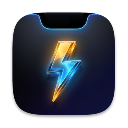

<h1 align="center">
  <br>
  <a href="https://github.com/Shaun-Z/power.notch">
    
  </a>
  <br>
  powerNotch
  <br>
</h1>

<p align="center">
  A macOS notch utility forked from and built upon <a href="https://github.com/TheBoredTeam/boring.notch"><strong>boringNotch</strong></a> by <a href="https://github.com/TheBoredTeam">TheBoredTeam</a>.
</p>

<p align="center">
  <a href="https://github.com/Shaun-Z/power.notch/actions/workflows/cicd.yml">
    
  </a>
  <a href="./LICENSE">
    
  </a>
</p>

---

> [!NOTE]
> **powerNotch** is an independent fork of **[boringNotch](https://github.com/TheBoredTeam/boring.notch)** ([TheBoredTeam/boring.notch](https://github.com/TheBoredTeam/boring.notch)). Full credit goes to TheBoredTeam and all boringNotch contributors for creating the original project and architecture. This repository tracks upstream boringNotch improvements while adding custom enhancements and rebranding.

Say hello to **powerNotch** — turning your Mac's notch or Dynamic Island into a music control center with real-time lyrics, calendar and reminders integration, a file shelf with AirDrop support, a mirror/webcam view, and replacements for volume and brightness HUDs.

## Features

- **Music Live Activity & Visualizer** — Dynamic playback controls and audio visualizer right in the notch (Apple Music, Spotify, YouTube Music, and system Now Playing).
- **Closed-Notch Real-Time Lyrics** — Displays synchronized lyrics below the closed notch with multi-source fallback (LRCLIB, NetEase, LewdHuTao, lyrics.ovh), adapted from [lycrics_notch](https://github.com/Dreammmmix/lycrics_notch).
- **Calendar & Reminders Integration** — Quick overview of upcoming events and reminders.
- **File Shelf with AirDrop Support** — Drag and drop files into the notch for temporary holding and quick sharing.
- **System HUD Replacements** — Sleek inline notch HUDs for volume, display brightness, and keyboard backlight.
- **Battery & Charging Indicator** — Live charging status and percentage indicator.
- **Mirror (Webcam)** — Quick camera preview directly from the notch.
- **Customizable Gestures & Sizing** — Fine-tune notch dimensions and interactions for different display sizes.
- **Liquid Glass & Dynamic Island** — Dark transparent glass, an optional rounded Dynamic Island contour, and an app-specific glass opacity control. Native Liquid Glass requires macOS 26 or later; earlier versions use a blur material fallback.
- **Physical Notch Blending** — A solid black collapsed surface and a static, soft pill-shaped ink blend in the expanded glass card. Top-edge reflections are suppressed on notched displays; displays without a physical notch do not use the ink blend.
- **Developer Options** — Unlock animation speed controls, a dark/clear glass switch, and per-display Dynamic Island position and height adjustments by clicking the version number five times in About.

## Installation

**System Requirements:**

- macOS **14 Sonoma** or later
- Apple Silicon or Intel Mac
- macOS **26 or later** for native Liquid Glass

### Option 1: Download from Releases

Download the latest `.dmg` from the [Releases](https://github.com/Shaun-Z/power.notch/releases) page, open it, and drag **powerNotch.app** into `/Applications`.

> [!IMPORTANT]
> Because this app is not notarized with an Apple Developer account, macOS may warn that powerNotch is from an unidentified developer on first launch. You only need to clear the quarantine attribute once:
>
> ```bash
> xattr -dr com.apple.quarantine "/Applications/powerNotch.app"
> ```
>
> Alternatively, open **System Settings** > **Privacy & Security** and click **Open Anyway** next to the powerNotch warning.

### Option 2: Building from Source

#### Prerequisites
- **macOS 15.6 or later**
- **Xcode 26 or later**

#### Steps
1. **Clone the repository:**
   ```bash
   git clone https://github.com/Shaun-Z/power.notch.git
   cd power.notch
   ```

2. **Open the project in Xcode:**
   ```bash
   open powerNotch.xcodeproj
   ```

3. **Build and run:**
   - Select the `powerNotch` scheme and press `Cmd + R`.

## Usage

- Launch **powerNotch** to activate the notch experience.
- Hover over or click the notch to expand controls, calendar, and shelf.
- Use the menu bar icon to open Settings and customize appearance, media controllers, lyrics, HUDs, and gestures.

### Glass appearance

Open **Settings → Appearance → Liquid Glass & Dynamic Island**:

- Enable **Liquid Glass expanded notch** for the glass background. Turning it off restores the solid black background.
- Adjust **Glass opacity** from **0% to 100%**. The slider uses a continuous normalized range, matching the system glass control rather than fixed percentage steps. Its value is saved for powerNotch, independently of the system glass transparency setting, and does not change other apps. The slider is disabled while Liquid Glass is off.
- Enable **Dynamic Island expanded shape** to morph the expanded wings and card into a rounded contour.

On macOS 26 or later, the default glass has a black tint, which remains as you adjust the material intensity; 0% does not mean a completely invisible card. Earlier versions adjust the fallback blur layer's opacity. On a display with a physical notch, the collapsed surface stays black. The expanded card uses a compact, static ink blend attached to the top edge to soften the transition from the hardware notch into the glass.

### Developer options

Open **Settings → About** and click the **Version** row **five times in quick succession** to reveal **Developer options** in the sidebar. The unlock and control values persist between launches.

| Control | Behavior |
| --- | --- |
| **Animation speed** | **0.1×–2×**, in **0.05×** steps. **1×** is normal speed; lower values slow card expansion/collapse, album artwork, and lyric motion. **Reset animation speed** restores 1×. |
| **Glass tint** | Switch between the default dark tinted glass and colorless clear glass. Enable Liquid Glass in Appearance to see the effect. |
| **Vertical offset** | Adjust each enabled display's Dynamic Island position from **−12 to +24 pt**, in **0.5 pt** steps. Positive values move it downward. |
| **Total height** | Adjust each enabled display's collapsed Dynamic Island height from **14 to 48 pt**, in **0.5 pt** steps. **Auto** restores the automatic height; **Reset** restores both position and height for that display. |
| **Show developer options** | Turn off to hide the tab; click the Version row five times to reveal it again. |

Per-display position and height overrides take effect when **Dynamic Island expanded shape** is enabled. Animation speed applies to the shared card, artwork, and lyric motion rather than every animation in the app.

### Expansion and collapse

The glass background, outline, and content clipping share the same animated surface geometry. The physical-notch ink blend stays static and is clipped by that surface. Use a slower animation speed in Developer options to inspect transitions on your display; the geometry synchronization has been checked in hosted-window tests, while visual behavior still needs confirmation on the target display.

## Contributing

Contributions are welcome! Please read [CONTRIBUTING.md](./CONTRIBUTING.md) before opening a pull request.

## Acknowledgments

**powerNotch** would not exist without the amazing open-source projects and communities behind it:

- **[boringNotch](https://github.com/TheBoredTeam/boring.notch)** by **[TheBoredTeam](https://github.com/TheBoredTeam)** — The original project that powerNotch is forked from. If you love this app, please consider starring and supporting the upstream boringNotch project!
- **[lycrics_notch](https://github.com/Dreammmmix/lycrics_notch)** — Inspiration and implementation reference for closed-notch real-time lyrics display.
- **[MediaRemoteAdapter](https://github.com/ungive/mediaremote-adapter)** — Enables Now Playing support on macOS 15.4+.
- **[NotchDrop](https://github.com/Lakr233/NotchDrop)** — Instrumental to the original Shelf feature in boringNotch.

For a full list of third-party licenses and attributions, see [THIRD_PARTY_LICENSES](./THIRD_PARTY_LICENSES).

## License

This project is licensed under the **GNU General Public License v3.0** — see [LICENSE](./LICENSE) for details.
